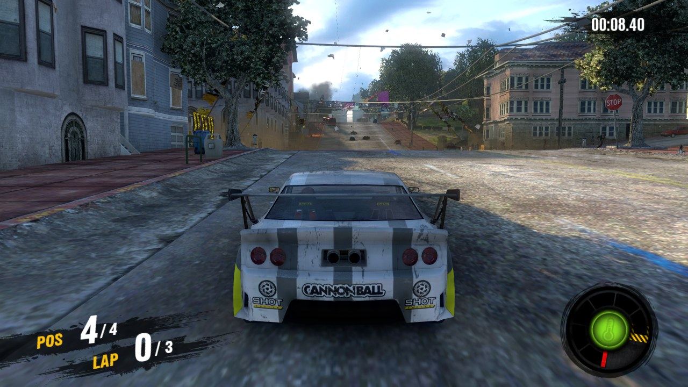
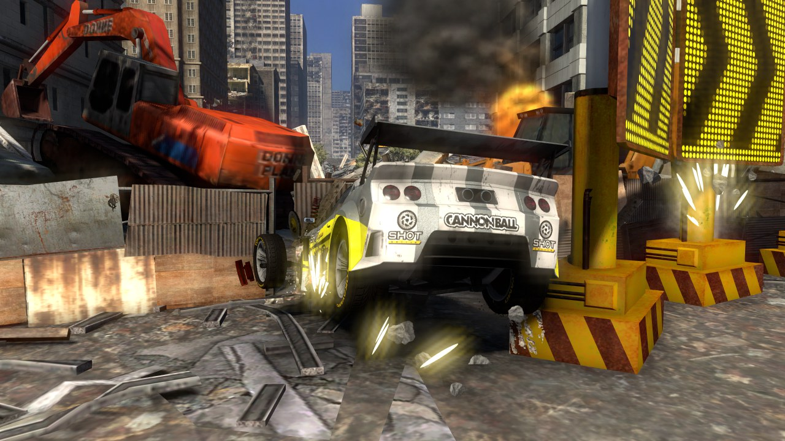
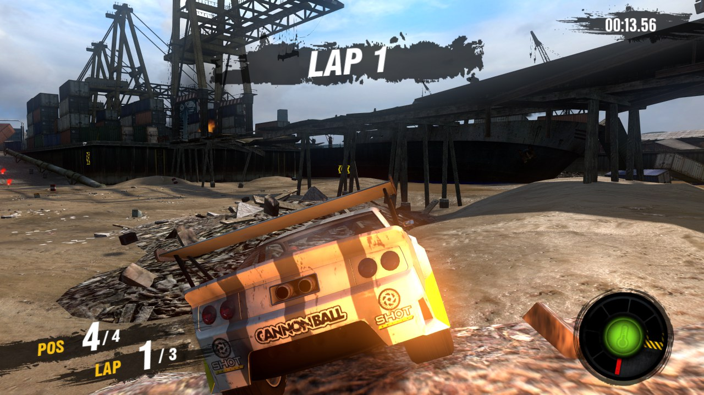

<h1 align="center">MotorStorm Apocalypse — native PC port (Linux, Vulkan)</h1>

<p align="center">
  
  
  
  
  
</p>

<p align="center"><b>MotorStorm Apocalypse PC port</b> · native on Linux · PS3 static recompilation · Vulkan</p>

<p align="center"></p>

**MotorStorm Apocalypse** (PS3, BCES-00484, version 01.00) running natively on
Linux, without an emulator. The game's code, PowerPC (PPU) and SPU, is
translated to C before compilation by static recompilation with
[ps3recomp](https://github.com/sp00nznet/ps3recomp). The PS3 system is
reimplemented, and the GPU (RSX) runs the game's own shaders translated to
Vulkan. The runtime started as a copy of the
[inFAMOUS 2 port](https://github.com/ThiagoFraga761/infamous2-pc)'s.

> **No game files come with this project.** To play you need your own copy of
> the game, dumped from your own disc. The build turns **your** executable into
> code on **your** machine, and that code must not be distributed.

<p align="center">
  
  
</p>
<p align="center"><i>1440p, native MLAA anti-aliasing, 60 fps simulation (shown here scaled to 1280×720).</i></p>

## Status

| Area | State |
|---|---|
| Lift (PPU + SPU) and link | ✅ 76,362 PPU functions plus the SPU job and task images (ps3recomp v0.18.0) |
| Boot, videos, menus | ✅ Boots to the main menu, navigable with a pad (intro movies decode and play) |
| Races, single player | 🔧 Races run start to finish with correct lighting, shadows and anti-aliasing; every track is being checked. ~60 fps at 720p and 1440p on a Ryzen 9 5950X (median frame 16.7 ms); dips in physics-heavy moments are being worked on |
| Split-screen (2–4 players) | 🔧 Races start and render correctly; 4 players run at ~34 fps (limited by the GPU command thread) |
| Audio, saves, controllers | 🔧 Saves and controllers work; race audio plays (the firmware's MP3 decoder is lifted from your own firmware) |
| Port menu, options, up to 4K, 60 fps | ✅ Start screen, in-game menu (F1), resolution scale 1–3 (720p / 1440p / 4K), 60 fps simulation (or 30 as on the PS3), performance HUD (F10) |
| Online play | ❌ Not planned (the servers are gone) |
| Windows | ❌ Not yet: the Vulkan backend is Linux-only |

Plan and progress: [docs/ROADMAP.md](docs/ROADMAP.md). Technical notes:
[docs/NOTES.md](docs/NOTES.md).

## What you need

**Game and firmware** (all from your own hardware and discs — see
[docs/REQUIRED_FILES.md](docs/REQUIRED_FILES.md) for the details):

- A disc dump of **MotorStorm Apocalypse, BCES-00484 (Europe), version 01.00**.
  No other region or version is supported: the port's addresses are those of
  this executable. Game updates (1.01, 1.02) are not used.
- [RPCS3](https://rpcs3.net), only to decrypt the game's executable and to
  install the official PS3 system software (firmware). RPCS3 is not used to
  run the game.
- The official PS3 firmware file (`PS3UPDAT.PUP`) from Sony's site, installed
  in RPCS3. The port reads fonts and system files from it, and lifts its MP3
  decoder for the race music.

**PC:**

- Linux x86-64. Developed on Pop!_OS 24.04 (Ubuntu 24.04 base).
- A CPU with AVX2 (AVX-512 is used when present). A fast 8-core or larger CPU
  is needed for 60 fps; the reference machine is a Ryzen 9 5950X.
- A Vulkan GPU and driver.
- A game controller (Xbox, PlayStation or any SDL-supported pad). On Linux
  there is no keyboard control.
- About 30 GB of disk space (the game itself is ~19 GB) and **at least 16 GB
  of RAM** to compile; the translated PPU code is very large.

**Packages** (Ubuntu / Debian / Pop!_OS names):

```sh
sudo apt install git build-essential cmake ninja-build clang python3 python3-venv \
    libsdl2-dev libvulkan-dev glslang-dev glslang-tools libpng-dev libfreetype-dev \
    zlib1g-dev libavcodec-dev libavformat-dev libavutil-dev libswresample-dev
```

GCC 13 and clang 18 are what the port is built with; the lifted PPU code is
compiled with clang (`clang++` must be on `PATH`), the rest with the system
compiler. FFmpeg is loaded at run time for the intro videos.

## Installing

### 1. Get the code

```sh
git clone <this repository> motorstorm_apoca
cd motorstorm_apoca
scripts/install-hooks.sh    # optional: blocks commits of game files
```

### 2. Dump the game

Dump your disc with your own PS3 (for example with a backup manager on a
console that can run one) or with a compatible Blu-ray drive. You need the
whole `PS3_GAME/` folder: `PARAM.SFO`, the icons, and `USRDIR/` with
`EBOOT.BIN`, `ms3.psarc`, `budgets/` and `ui/`.

### 3. Install the firmware in RPCS3

Install RPCS3 (Flatpak or native), then *File → Install Firmware* and pick
`PS3UPDAT.PUP`. The port finds it on its own in either place
(`~/.var/app/net.rpcs3.RPCS3/config/rpcs3/dev_flash` or
`~/.config/rpcs3/dev_flash`). Elsewhere, point `PS3_DEV_FLASH` at the
`dev_flash` folder.

### 4. Decrypt the executable

`USRDIR/EBOOT.BIN` is encrypted. In RPCS3: *Utilities → Decrypt PS3
Binaries*, select `EBOOT.BIN`. Keep the result as `EBOOT.elf`. It must be:

```
sha256 387c9fb795e1709bd2cf1a1145c0548a0fc911a295aa860a27b41441a15418ff
size   21318304 bytes
```

```sh
sha256sum EBOOT.elf
```

### 5. Put the game files in `disc/`

`disc/` is ignored by git. Copy the dump there, or link to it so the 19 GB
are not copied (adjust `SRC`):

```sh
SRC=/path/to/your/dump/PS3_GAME
mkdir -p disc/PS3_GAME/USRDIR
for f in "$SRC"/*; do [ "$(basename "$f")" = USRDIR ] || ln -s "$f" disc/PS3_GAME/; done
for f in "$SRC"/USRDIR/*; do [ "$(basename "$f")" = EBOOT.BIN ] || ln -s "$f" disc/PS3_GAME/USRDIR/; done
cp /path/to/EBOOT.elf disc/PS3_GAME/USRDIR/
```

The result:

```
disc/PS3_GAME/
├── PARAM.SFO, ICON0.PNG, PIC0.PNG, PIC1.PNG, SND0.AT3, ...
└── USRDIR/
    ├── EBOOT.elf     # the decrypted executable (a real file, not a link)
    ├── ms3.psarc
    ├── budgets/
    └── ui/
```

### 6. Build

```sh
scripts/setup.sh    # fetches ps3recomp at the pinned commit, applies this port's patch, Python venv
scripts/lift.sh     # translates the PPU and SPU code of YOUR EBOOT.elf (checks its hash)
scripts/build.sh    # compiles into work/port/build-vk
```

`lift.sh` takes about 12 minutes and `build.sh` about 35 with the defaults
(4 jobs, 14 GB memory cap), measured from a fresh clone on a Ryzen 9 5950X. With more RAM, raise both, for example
`JOBS=16 PORT_BUILD_MEM=48G scripts/build.sh` (each job can need ~3 GB).
A build that runs out of memory is stopped by the cap rather than freezing
the machine; run it again with fewer jobs and it carries on where it stopped.

Optional: `work/pgo/ppu.profdata` and `work/pgo/spu.profdata`, when present,
are used for profile-guided optimisation. They are not shipped; the port runs
without them, somewhat slower.

### 7. Play

```sh
work/play.sh            # start screen, then the game
work/play.sh --play     # straight into the game
```

Connect the controller before starting. Each run's log goes to
`work/runs/play-<time>.log`. Saves and settings stay in the repository folder
(`hdd0/`, `user/`), all git-ignored.

## Settings and keys

The start screen and the in-game menu (**F1**) write `user/settings.ini`;
the file can also be edited by hand (a variable set in the environment wins
over it):

| Setting | Values |
|---|---|
| `scale` | 1 = 720p, 2 = 1440p, 3 = 4K (the window opens at that size) |
| `fullscreen`, `vsync`, `stretch`, `display` | full screen; vsync; stretch instead of black bars; which monitor |
| `frame_rate` | 60, or 30 as on the PS3 |
| `fps_limit` | 0 = none |
| `fps_counter` | performance HUD: 0 off, 1 detailed, 2 compact |
| `fullres_particles`, `aniso` | particles at full resolution; anisotropic filtering 2–16 |

| Key | |
|---|---|
| F1 | port menu |
| F10 | performance HUD: detailed / compact / off |
| F11 or Alt+Enter | full screen and back |
| Esc | quit |

On a scaled Wayland desktop (125%, 150%, ...) the window is sized in real
pixels, so 1440p is 2560×1440 screen pixels. `PS3RECOMP_VK_X11=1` uses
Xwayland instead of native Wayland.

## Troubleshooting

- **`lift.sh` warns about the sha256:** the executable is not the
  BCES-00484 01.00 one, or it was not decrypted. Only that version works.
- **No sound in races / missing fonts:** the firmware is not installed in
  RPCS3, or `PS3_DEV_FLASH` does not point at its `dev_flash`.
- **The build is killed:** the memory cap was hit; lower `JOBS` or raise
  `PORT_BUILD_MEM` (with a unit, e.g. `24G`).
- **No controller:** connect it before starting; SDL picks controllers up at
  launch.
- **Bugs:** include the `work/runs/play-<time>.log` of the run. Do not attach
  game files or anything under `work/src/` or `work/port/spu/` — that is the
  game's code.

## Contributing

See [docs/GITHUB_SETUP.md](docs/GITHUB_SETUP.md). Changes to ps3recomp go in
`work/patches/ps3recomp.patch` (`scripts/make_patch.sh`). The tests are in
`work/tests/` (`work/tests/run_all.sh`).

## Credits

See [CREDITS.md](CREDITS.md).

## License

MIT for the code in this repository; see [LICENSE](LICENSE). MotorStorm
Apocalypse and its content belong to their owners (Evolution Studios / Sony
Interactive Entertainment). This is a research and preservation project; it
contains no game code or assets.
